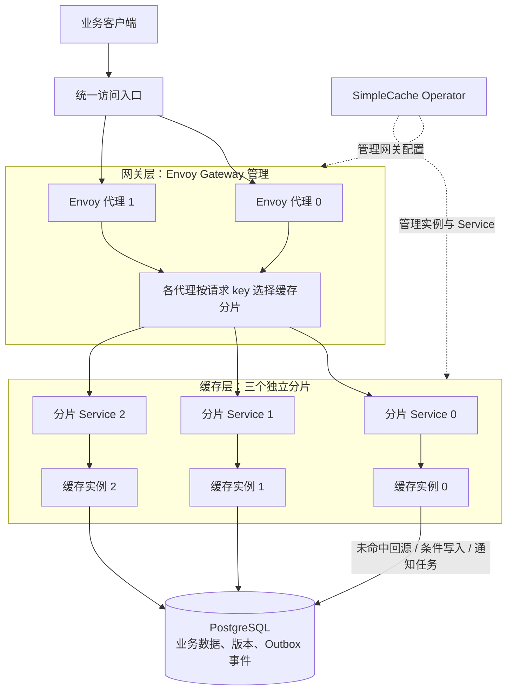
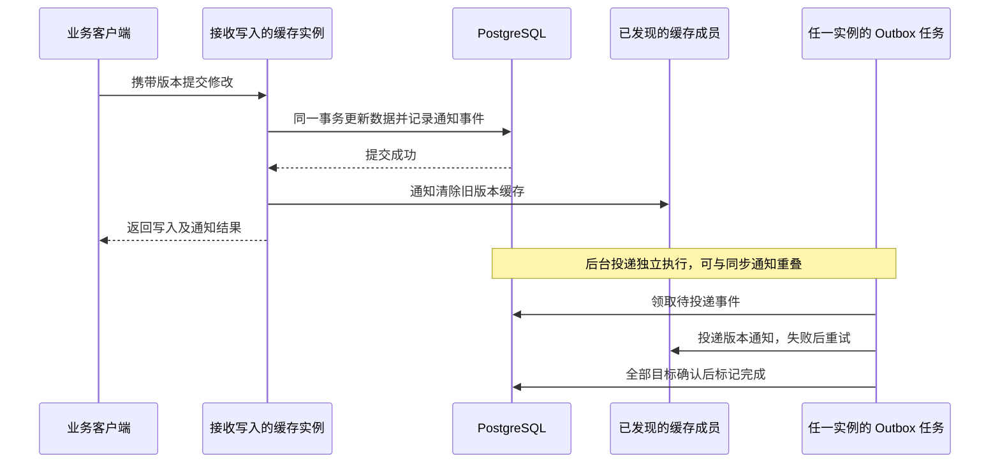

# SimpleCache

SimpleCache 是一个用 Go 实现的分布式加载式缓存，配套 Kubernetes Operator，以商品 JSON 为例验证读多写少场景下的缓存、条件写入和故障恢复。

**PostgreSQL 保存业务数据和版本，缓存实例按键分担读取压力。** 读取未命中时从数据库加载；写入先提交数据库，再通知各实例清除旧缓存。事务 Outbox 持久化通知事件，让写入实例故障后仍能继续投递。

## 整体架构

下面展示可选的 **Gateway 模式：两个代理实例、三个缓存分片、一个共享 PostgreSQL**。



图中的分片选择是代理内部逻辑，不是额外服务。每个分片 Service 对应一个缓存 Pod，三个实例保存不同键的缓存，当前没有为每个分片配置缓存副本。代理配置和健康状态一致时，同一个键会路由到同一分片；扩缩容或故障期间路由会逐步收敛。

| 组件 | 职责 |
| --- | --- |
| Envoy 代理 | 接收请求，按键选择分片，支持多个代理实例 |
| 缓存实例 | 提供读写 API；维护本地 LRU/TTL 缓存；合并同键请求并限制回源并发；发送和接收失效通知 |
| PostgreSQL | 保存权威数据和版本，原子检查写入条件，同时记录 Outbox 事件 |
| Outbox 后台任务 | 运行在缓存实例中，领取通知事件并重试；实例故障后由其他实例接续 |
| Operator 与服务发现 | Operator 管理部署资源；缓存实例通过 EndpointSlice 发现失效通知的目标成员 |

项目默认使用 **Peer 模式**，无需 Envoy：客户端访问任一缓存 API，未命中时按一致性哈希找到负责该键的实例。Gateway 模式把分片选择前移到代理，缓存实例直接处理本地读取，减少一次实例间的读取转发。两种模式共用数据库和版本失效机制。

## 读写如何工作

**读取：** 请求到达对应分片后，优先返回本地缓存；未命中则读取 PostgreSQL 并缓存结果。同键并发请求共享加载任务，容量不足时明确拒绝，避免无限排队和集中回源。

**写入：** 客户端携带读取到的版本提交修改。数据库检查版本，成功后同时更新数据并记录通知事件；版本不匹配则返回 `412`，避免覆盖其他请求已提交的修改。



同步通知用于尽快清除旧缓存，Outbox 用于故障后的持续重试。通知可能重复或乱序，缓存会检查版本，避免旧通知清除更新的数据。

**一致性边界：** 这里不提供强一致读，写入后可能短暂读到旧缓存。通知完成只覆盖当次已发现的成员；离线或未发现的旧缓存仍依赖 TTL 过期恢复。一份 Outbox 队列服务于同一个缓存集群。

## 快速开始

### 本地单实例

使用兼容 Go 1.25.3 的工具链，在一个终端启动内置演示数据源：

```bash
cd geecache-engine
go run -buildvcs=false ./cmd/simplecache -port=8001 -api=true
```

在另一个终端读取数据：

```bash
curl -fsS 'http://localhost:9999/api?key=Auto-666'
```

### 三实例与 PostgreSQL

在仓库根目录启动 Compose 示例，使用默认 Peer 模式：

```bash
docker compose -f deploy/products/compose.yaml up -d --build
curl -fsS http://127.0.0.1:19999/readyz
curl -fsS 'http://127.0.0.1:19999/api?key=product:42'
```

使用结束后关闭资源，保留数据库卷：

```bash
docker compose -f deploy/products/compose.yaml down
```

已有数据库卷需要先执行[显式结构升级](docs/design.md#postgresql-example)。条件写入示例、鉴权配置和 Kubernetes / Gateway 部署见[中文设计文档](docs/design.zh-CN.md#run-and-configure)。

## 测试与验证

```bash
make check                         # Go 格式、测试、race、构建和静态检查
make test-operator-ci              # Operator 测试
make gateway-smoke                 # 真实 Gateway 与 PostgreSQL 集群冒烟验证
make gateway-experiments           # 并发、通知丢失与故障恢复场景
make gateway-perf                  # 随机路由与哈希路由的对照实验
make postgres-compare COMPARE_QUICK=1  # PostgreSQL 路径快速验证
```

测试覆盖版本冲突、旧响应晚到、重复和乱序通知、提交后崩溃、Outbox 重放及过载保护。集群实验使用独立的临时 Kind 环境，报告保存在 `bin/reports/`。功能测试通过不代表已经测得容量上限，具体证据与限制见[验证说明](docs/design.zh-CN.md#validation-and-evidence)。

## 目录与文档

| 目录 | 内容 |
| --- | --- |
| `geecache-engine/` | 缓存引擎、数据源、通知任务及 Go 测试和压测工具 |
| `simplecache-operator/` | Kubernetes API、控制器和部署资源 |
| `deploy/` | 本地 Compose、Kubernetes、Gateway 与监控示例 |
| `tools/validation/` | 集群生命周期、功能与故障实验、性能测量和报告 |
| `scripts/` | 开发脚本与兼容入口 |
| `docs/` | 设计、配置、验证证据和后续计划 |
| `.github/workflows/` | 持续集成检查 |

深入阅读：[中文设计文档](docs/design.zh-CN.md) · [完整设计与操作指南（英文）](docs/design.md) · [引擎模块索引](geecache-engine/internal/README.md) · [Outbox 协议说明](geecache-engine/internal/outbox/README.md)。
