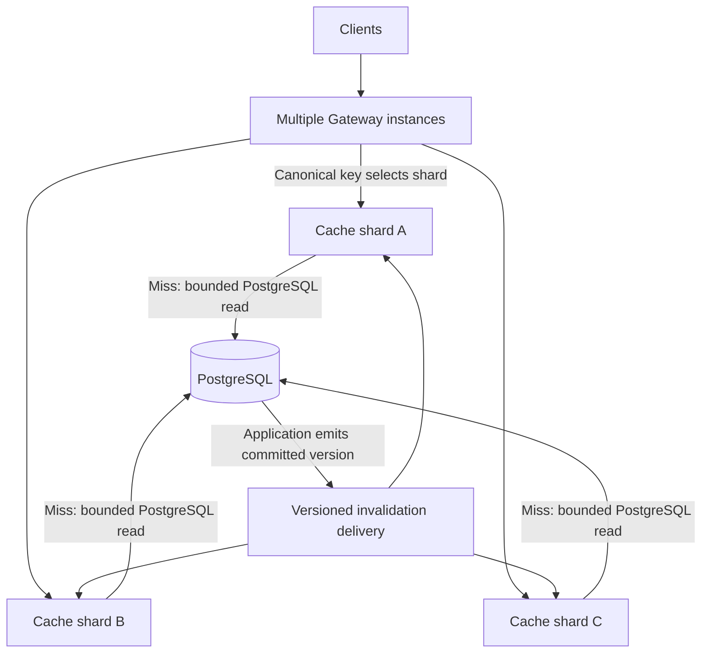

# SimpleCache: architecture, operation, and roadmap

Documentation updated 2026-10-29. Main fb139ea includes Gateway routing,
conditional writes, bounded version floors, active expiration and the combined
26-check functional experiments. This working tree adds paired in-cluster
routing measurements. Durable notification delivery and cache replicas remain
optional future work; historical measurements retain their original scope.

This is the project's single detailed guide. [README](../README.md) is the
quick start; the Operator README only links here. Per-run logs, measurements
and profiles remain under ignored `bin/reports/` as evidence, not separate guides.

- [Current implementation](#current-implementation)
- [Agreed target architecture](#agreed-target-architecture)
- [Run and configure](#run-and-configure)
- [Validation and evidence](#validation-and-evidence)
- [Delivery plan](#delivery-plan)

## Current implementation

SimpleCache is a Go loading cache with a Kubernetes Operator. PostgreSQL owns
persistent values. Product JSON is a repeatable read-mostly example; the engine
is not an inventory, order or task-processing service. The immutable demo remains
available for isolated cache and platform diagnostics.

| Concern | Implemented now | Agreed next direction |
| --- | --- | --- |
| Authority | PostgreSQL owns values and per-key increasing versions | Keep PostgreSQL authoritative |
| Reads | Opt-in Gateway -> local cache/source; legacy Peer routing remains the default | Use paired route evidence; establish isolated baselines before capacity/SLO claims |
| Writes | Authenticated create/update/delete with atomic source-version checks | Business services add their own predicates/transactions as needed |
| Invalidation | Version-bearing best-effort HTTP fan-out, bounded floors and 256 epoch stripes | Durable delivery/catch-up only if required |
| Expiration | Lookup-time checks plus bounded lifecycle-owned cleanup | Evaluate reclamation behavior under larger working sets |
| Protection | Bounded API/Peer miss waiters, shared routes, source queue and writes | Validate budgets against real container memory and workloads |
| Replication | Disposable hot copies, no replicated shard groups | Start without cache replication; add only for measured recovery needs |
| Deployment | StatefulSet, optional Envoy Gateway with multiple proxies and stable shard Services | Retain EndpointSlice discovery for invalidation; no cache replica groups |

### Current read path and protection

Gateway mode (`READ_ROUTING_MODE=gateway`) reads directly:

```text
client -> Envoy proxy (Maglev hash of canonical query key)
       -> shard Service (one StatefulSet ordinal) -> cache Pod API
       -> main LRU; miss -> originFlight -> bounded source task -> PostgreSQL
```

The cache API uses GetDirect: no routeFlight, second hash decision or Peer read.
API miss admission, source queue/concurrency limits, cancellation isolation, local
epoch fencing and TTL maintenance remain. The member directory builds clients
for invalidation without building a read hash ring. HOT_CACHE_BYTES must be zero.
The following path describes the default legacy Peer mode:

```text
GET /api?key=... -> validate -> main LRU -> optional hot LRU
  hit: ByteView.WriteTo -> API response
  miss: immutable-source Bloom, if available -> routeFlight
    preferred owner is self / empty ring: local load
    other owner: one HTTP/Protobuf Peer request -> remote GetLocal
      local main/hot -> originFlight -> second lookup -> source slot
      -> Getter -> validate local epoch -> fill main and clear same-key hot
  Peer success: return; optionally admit to hot with valid expiry/epoch
  Peer failure: local source fallback within remaining route wait budget
```

Peer handlers never route to another Peer. Separate route/source SingleFlight
avoids recursive same-key waiting. Each caller may cancel its own wait; shared
work uses the service lifecycle and its own deadline. Caller cancellation does
not call Forget or cancel work still useful to other waiters.

| Budget | Current default |
| --- | --- |
| API read wait | 1500ms |
| Shared routing task | 1200ms |
| One Peer read | 1000ms |
| Source task, including slot wait | 800ms |
| Executing source Getter calls | 32 per process |

Budgets are not a simple serial sum: independent source work can finish after
a route stops waiting. A late Peer failure can leave too little route time for
fallback to return to that caller. Source implementations must honor context.
Read admission has separate API and Peer miss-waiter lanes (128 each by
default), plus a separate shared-route task bound of 128. Hits bypass these
budgets; probes and incoming Peer invalidations do not wait behind miss callers.
Route slots are acquired inside SingleFlight and held until shared work ends,
even if its caller cancels. Local source fallback does not acquire a second Peer
waiter slot. Same-key callers share work, but each waiting caller still consumes
one waiter slot.

The source limiter allows 32 executing Getters plus at most 128 queued tasks;
queued time remains part of the 800ms source budget. Queue capacity zero rejects
immediately when execution slots are full. Writes/cache-only invalidation API
requests have a separate default concurrency bound of 16, acquired after
authentication/key checks and before body buffering. Rejection returns 503 with
Retry-After: 1 instead of waiting in another unbounded queue. Stale-version source results receive at most one retry inside the original
800ms source budget, with the same waiter and normal source admission. Other
errors and writes are not automatically retried. The retry retains the highest
version observed during rejection even if its bounded metadata record is retired. API/Peer response writes have
a 10s deadline covering body reads and bounded mutation work.

These are application-work count limits, not a bound on all net/http connections,
slow clients, response memory, process RSS or cluster-wide DB work. Value sizes,
Go runtime headroom and the sum of per-Pod budgets still need container testing.
A process-local limit must not be described as a global database quota.
PostgreSQL pool MaxConns follows SOURCE_MAX_CONCURRENCY, with MinConns=0;
source writes use the pool and their own timeout, not the read-Getter slots.

Only 404 with `X-SimpleCache-Error: KEY_NOT_FOUND` is a terminal Peer business
miss. Unknown groups, untyped 404s, transport/protocol failures and oversized
responses may fall back. A typed Peer 503 with X-SimpleCache-Error: OVERLOADED
is propagated without
local source fallback, avoiding extra source pressure when the owner rejects
work; other network/protocol failures retain existing fallback. Public errors
include invalid key 400, missing key 404, overload/source failure 503 and
timeout 504. Peer body length is checked before decoding
and the value is checked afterward. Paths preserve escaped Unicode, slash,
space and plus characters; the HTTP transport reuses connections and rejects
redirects. Protobuf is used over HTTP, not gRPC.

### Cache storage and local fencing

Main/hot LRU areas use a map plus doubly linked list and separate mutexes.
Successful lookups move recency and therefore cannot simply use an RLock.
Logical accounting is key bytes plus value bytes, excluding Go objects, maps,
list/expiry/version metadata, requests and runtime overhead. CACHE_BYTES is not an RSS
limit. Oversized entries are returned without flushing unrelated cached entries.
Expiration is checked on lookup. One lifecycle-owned maintenance worker also
runs every second, inspecting at most 128 entries and a best-effort 2ms work
budget per main/hot area per cycle. A persistent list cursor avoids copying all
keys; deletion/eviction advances it so a recreated key cannot be removed through
an old element. Maintenance does not refresh recency or TTL, mutate source
versions, or increment invalidation epochs.

A busy cache mutex is skipped with TryLock, not waited on; the timer is stopped
on lifecycle cancellation. This is opportunistic reclamation, not a real-time
expiry deadline: unvisited expired entries can remain counted, goroutine
scheduling can exceed the work budget, and clearing references does not force
immediate GC/RSS return. No database scan or topology-driven deletion is added.

HOT_CACHE_BYTES defaults to zero. When enabled it reserves part of CACHE_BYTES:
64MiB total with 8MiB hot leaves 56MiB main. It admits fitting Peer results to an
LRU, not a frequency-based hot-key detector. Copies expire at the minimum of
remaining owner lifetime and one second, without renewal on hit. The Peer TTL
header is `X-SimpleCache-TTL-Nanoseconds`; the client conservatively consumes
the whole request duration. Missing/zero TTL permits the read but not hot
admission. Invalid TTL is a protocol error. Peer responses also carry
X-SimpleCache-Version; main/hot and routed replies retain the version paired
with the source bytes. Missing metadata on legacy responses means unknown
version, not permission for an unconditional write. Invalid versions fail the
Peer protocol check. Relative TTL needs no wall-clock
synchronization across nodes.

Values are copied on admission and ByteSlice still returns a defensive copy.
API success uses WriteTo under the io.Writer contract, removing one extra slice
copy. This does not mean zero-copy networking or an allocation-free HTTP request.

Each Group has 256 fixed FNV-1a epoch stripes. Force invalidation always
advances a stripe; a versioned notification advances it when announcing a
version beyond the key's already known floor/resident version. Epoch and source
version are separate: epochs detach local work, while source versions compare
values belonging to the same key. Source/route flight identities include epoch,
minimum observed version and key. A new caller need not join older/weaker work.
Fill admission shares epochMu with notification processing, preventing old work
from refilling after an observed fence. Collisions conservatively reject another
key's in-flight fill but do not evict its unrelated resident value.

Version floors live independently of cached values, so value eviction or TTL
expiration does not immediately forget a delivered notification. Each Group
retains at most **1,024** records. Keys are cloned (at most 256 bytes each),
avoiding retention of a large request URI through a substring. Records are
retired in order of last version advancement; reads and duplicate/older events
do not refresh that order. This metadata is additional to CACHE_BYTES, not an
RSS quota or a durable record of every key's maximum version.

Retiring a floor advances its stripe again, fencing work that started before
retirement. Active flights also retain their captured minimum as a scalar, even
if the shared record is evicted. Peer fallback inherits that minimum and cannot
join a weaker source flight or use a lower-version cache hit. Successful source
results below the captured/current known version are rejected with HTTP 503;
older/unversioned Peer values fall back to the primary source, even with hot
caching disabled. An unversioned Peer 404 also falls back when a version floor
is known. Source absence is not cached and carries no tombstone-version read
promise; this does not introduce a public minimum-version/linearizable-read API.

Once a floor is retired and active work ends, new callers can no longer rely on
that forgotten per-key history. They use resident versions, the authoritative
primary source, existing Peer/TTL rules and future notifications. A restarted
node loses both cache and floors and starts cold; a missed notification is not
replayed automatically. Retention pressure, reconnects and unseen writes still
allow old reads under the existing weak consistency contract. The single-stripe
diagnostic option remains available for historical comparisons.

Bloom is initialized from a complete immutable key set only. The demo has Tom,
Jack, Sam and Auto-0 through Auto-9999, with 100ms simulated source latency.
Mutable PostgreSQL sources disable startup Bloom, even if a future adapter
exposes Keys(), so newly inserted values cannot be rejected by an old key set.

### Membership, Operator and lifecycle

In legacy Peer mode the Router uses CRC32 and 100 virtual nodes per member. Stable Kubernetes
identity is namespace/podName; IP:port is only the transport address. Updating an
address does not redefine the node's hash identity. Sort/deduplicate and collision
handling are deterministic. One update worker builds an immutable ring, clients
and member list, then publishes through atomic.Pointer. A route reads one
snapshot; published state is never mutated. Equal member sets are not republished.

Each cache Pod watches all EndpointSlices selected by namespace and peer Service
label. It accepts valid IPv4 Pod endpoints with a named peer TCP port, excludes
ready=false and terminating entries, and accepts unknown readiness. Events
coalesce into a rebuild signal; rebuilding reads the informer store as a whole.
Initial synchronization and successful publication allow readiness, including an
empty valid set. Readiness does not wait for this Pod's own endpoint. Watch
failures retain the last valid view and record errors; views converge eventually,
without simultaneous cluster-wide switching. No proactive cache migration occurs.

The Operator always creates six base resources: a StatefulSet, headless peer Service, API
ClusterIP Service, ServiceAccount, namespace discovery Role and RoleBinding.
Reconcile fetches the CR, checks deletion, defaults/validates a copy, applies
owned resources with CreateOrUpdate, checks rollout, and patches changed Status.
Owns watches drive child repair. Ownership conflicts are reported instead of
adopting unrelated resources. Allocated Service addresses, immutable workload
identity, API defaults and unrelated Pod fields are preserved.

| Current CR field | Meaning/default |
| --- | --- |
| size | Cache Pod count; default 3, range 1-10 |
| image | Required cache image |
| cacheBytes | Per-Pod logical total; default 64MiB, range 1-128MiB |
| hotCacheBytes | Reserved hot share; default 0, nonnegative and below cacheBytes |
| ttlSeconds | Main TTL; default 60, range 1-3600 |
| maxMissWaiters | Default 128, range 1-4096, applied separately to API/Peer waiting lanes and shared route tasks |
| sourceMaxPending | Default 128, range 0-4096; explicit zero disables the source queue |
| maxConcurrentWrites | Default 16, range 1-256; write/invalidation API concurrency |
| resources | Requests/limits; default CPU request 100m, memory request 128Mi and limit 256Mi |
| sourceSecret | Optional same-namespace DATABASE_URL and CACHE_ADMIN_TOKEN Secret |
| gateway | Optional; className defaults to eg, replicas defaults to 2 (1-8); enables direct reads and requires hotCacheBytes=0 |

Resource defaults respect explicitly smaller limits; negative budgets or requests
exceeding limits are rejected. Status contains observedGeneration, readyReplicas
and Ready conditions with InvalidSpec, ResourceConflict, ReconcileFailed,
Reconciling or Ready reasons. Ready checks StatefulSet observed generation,
ready/updated replicas and revisions, not global ring agreement or ongoing DB
health. Gateway mode also waits for the current GatewayClass acceptance,
Gateway acceptance/programming, HTTPRoute Accepted/ResolvedRefs and Backend/
BackendTrafficPolicy acceptance. A configured but disabled/unavailable gateway
reports GatewayUnavailable; unaccepted owned resources report GatewayPending.
These statuses do not prove simultaneous health/route views on every proxy.
New sets use Parallel; compatible existing immutable policy is preserved.

Scaling changes replicas without rewriting a PEERS list in the Pod template.
Image/config/Secret-reference changes may roll Pods. The controller injects
SecretKeyRef rather than reading credentials or deploying the database. Secret
content changes alone require controlled Pod restarts. Deleting a CR relies on
OwnerReferences and Kubernetes GC, with no external-resource finalizer. Manual
CR updates are the replica authority; HPA must not independently fight that value.

All listeners bind before serving/discovery readiness. Startup/liveness use
/healthz; readiness uses /readyz and discovery initialization. Shutdown marks
unready, drains HTTP for up to 5s, then cancels shared work; Pod grace is 10s.
PostgreSQL connectivity/schema are checked at startup, not on every probe.

### Current write and consistency contract

| Operation | Implemented behavior |
| --- | --- |
| GET /api?key=... | Local/Peer/source read |
| PUT /api?key=... | Validate JSON, conditional create/update, then invalidate |
| DELETE /api?key=... | Conditional logical deletion retaining its generation, then invalidate |
| POST /invalidate?key=... | Cache invalidation only; optional committed-version header after external writes |
| Peer DELETE /_geecache/products/... | Authenticated local invalidation, no rebroadcast |

Keys are 1-256 bytes; values are at most 1MiB, encoded Peer bodies at most
1MiB+1024. PostgreSQL stores bytea with size checks; the API validates JSON.
Mutation endpoints require a configured token and version-aware mutable source.
GET returns ETag: "vN" for PostgreSQL values, including Peer and hot hits. Values
and versions are fetched by one query and retained together. Demo remains
read-only and unversioned. Mutation contracts are:

- Replace: PUT with one exact strong If-Match ETag from a prior read.
- Create: PUT with If-None-Match: *; an existing live row fails the condition.
- Delete: DELETE with one exact strong If-Match ETag.
- Missing precondition: HTTP 428. Weak/list/wildcard If-Match, conflicting or
  duplicate headers, and unsupported conditions: HTTP 400. This API intentionally
  supports a single version token, not every form of HTTP conditional syntax.
- Source mismatch, including stale update/delete or duplicate creation: HTTP 412,
  source_committed=false and no invalidation; the database value is unchanged.
- Successful PUT/DELETE returns source_version; PUT also returns its ETag. A
  repeated delete with its original ETag fails once the representation is gone.
  POST /invalidate remains independent of mutation preconditions.

The source uses a bigint version incremented in the same SQL statement as the
mutation, never a read/check followed by an unconditional write. Delete clears
payload bytes and retains a tombstone/version; recreation increments that version
instead of restarting at one. Tombstones have no automatic GC: physically removing
them can let an old ETag match a recreated key unless a separate generation scheme
is retained. Conflicts require re-reading/reconciling client intent, not blind retry.

Trusted source-side Put/Delete helpers exist for fixtures/external writers, and
also advance generations; the public API does not use them to bypass conditions.
Direct SQL writers must preserve the same version rules and explicitly invalidate.
Workload JSON versions are content checks, distinct from the source version column.
No task idempotency or minimum-version read API is introduced here.

A lifecycle-owned 3s write task gives the source 800ms and broadcast 1s. Caller
disconnect does not cancel post-commit invalidation. Successful writes broadcast
the actual SQL RETURNING version. The initiating node applies the same rule as
remote nodes, using at most eight workers against one known-member snapshot.
Unknown/older cached values are removed; an equal/newer value keeps its payload,
recency and original expiry. Duplicate/older events do not detach a current flight
or lower retained versions. Peer handlers apply notifications locally only.
Ambiguous source errors still trigger force invalidation without inventing a
committed version; a source adapter returning a nonpositive successful version
is treated as an unknown outcome, not a successful versioned commit.

- HTTP 200 with source_committed=true means all targets in this attempt
  acknowledged the announced version, not that every possible reader is synchronized.
- HTTP 202 with source_committed=true means incomplete fan-out; failed/time-out
  targets are reported, the source is not rolled back, and no retry is scheduled.
  A peer returning 204 without the matching version acknowledgement is marked
  unversioned and also produces 202 for a versioned broadcast.
- HTTP 412 is a known failed condition and performs no mutation or broadcast.
- Source errors return 503/504 and source_committed=null: commit status can be
  unknown. Verify the outcome before repeating the business mutation.

The optional request/acknowledgement header is
`X-SimpleCache-Invalidation-Version: N` (one canonical positive int64).
Explicit zero, negative/overflow values, leading zeros, lists and duplicate
headers fail with 400 before cache mutation. New Peer handlers echo the requested
version after processing it, including an event ignored because a newer value
already exists; this is a processing acknowledgement, not the current cached
version or a durable watermark. The JSON invalidation report includes `version`.
Only POST /invalidate accepts this header from API clients; PUT/DELETE derive the
version from the database and reject client attempts to supply it.

An absent header retains force invalidation for legacy senders, manual cache
clearing and unknown commits. Force clearing preserves the highest already known
version; it does not assert a new source generation. New senders distinguish a
legacy 204 without a version echo from a modern acknowledgement. Mixed clusters
therefore remain usable while explicitly reporting the weaker delivery outcome.
External writers must announce the version returned by their own committed SQL,
not an application counter, wall-clock timestamp or client-provided guess.

Epoch fencing is local. In-flight distributed reads, omitted/offline nodes and
crashes between commit and notification can expose old values. TTL is a fallback,
not a linearizability or fixed-time-since-commit guarantee. A cached old value can still be read temporarily, but its ETag cannot overwrite
a different current source version. Local epoch remains a fill fence, not a
substitute for the database condition. No durable notification/replay or replicated cache protocol exists.

## Agreed target architecture

**Gateway key routing -> local cache with bounded source work -> PostgreSQL;
conditional database writes -> versioned invalidation.** PostgreSQL stays the
sole authority. Start with one disposable cache copy per shard. Replicas are an
optional recovery optimization, not a requirement for the cache to be useful.



The event path is produced by application code after commit; the current
PostgreSQL adapter does not automatically publish it. The Gateway read path is now implemented as an opt-in deployment;
versioned invalidation is now implemented with bounded local floors. It still
has no durable event relay, global reader barrier or guaranteed retained floor
at every possible holder.

### Routing and shard boundaries

A cache shard owns a subset of keys, not a separate PostgreSQL database.
The implementation uses **Envoy Gateway v1.9.2 / Gateway API v1.6.1**;
BackendTrafficPolicy selects ConsistentHash (Maglev, tableSize 65537) using the
single `key` query parameter. It uses existing Envoy proxies, not a custom proxy.
These vendor policies are not portable guarantees of every Gateway API controller.

The Operator creates one EnvoyProxy, Gateway, HTTPRoute, Backend and
BackendTrafficPolicy per cache CR, plus one native ClusterIP Service per shard.
Each shard Service selects exactly one StatefulSet ordinal. A single Backend
contains those stable Service IPs, so all endpoints belong to one hash cluster.
Using several weighted HTTPRoute backendRefs would introduce a separate cluster
choice and would not provide the same consistent-hash behavior.

This design deliberately pays for an ordinary L4 Service translation: Envoy
hashes stable Service IPs rather than changing Pod IPs, and the selected Service
has only one Pod candidate. There is no second application HTTP forwarding hop.
Pod replacement keeps the Service address; deleting/recreating a Service changes
its identity. StatefulSet ordinals now have an explicit routing purpose without
requiring PVCs. Services/backend entries grow with the shard count (currently
bounded at ten); a different stable endpoint mechanism may be preferable at scale.

Every proxy actively probes `/readyz` through each shard Service (2s interval,
1s timeout). Stable backend/configuration/health views give matching key affinity
across proxies. xDS delivery and health convergence are asynchronous: temporary
remapping, duplicate loads or request failures remain possible during changes.
There is no instantaneous global route switch, automatic data migration or warm
replica failover. Cold shards read the authoritative PostgreSQL source within
per-process limits. Scaling proxies/caches does not establish a global DB quota.

**Gateway mode API contract:** exactly one `key` parameter, canonical UTF-8 URL
encoding, uppercase percent escapes, `%20` for spaces, and no other parameters.
For example `key=product%3A42` is accepted; raw `key=product:42`, lowercase
`%3a`, `+` for space, duplicate keys and extra parameters return 400 before
source access. Envoy hashes the raw wire value, so rejecting alternate encodings
prevents one decoded source key acquiring multiple placements. GET, conditional
PUT/DELETE and POST /invalidate share this rule. Ordinary URL encoding libraries
can produce it; the legacy Peer-mode API retains its original query behavior.
`X-SimpleCache-Node` identifies the responding worker for functional checks and
diagnosis; it is not a consistency or placement authority.

Cache nodes still discover ready members for best-effort invalidation fan-out,
including copies left by earlier routing views. They retain scoped EndpointSlice
RBAC; this stage does not claim to remove all API watches from cache Pods.
Gateway mode bypasses normal read forwarding, routeFlight and hot copies while
preserving source coalescing, bounded work, lifecycle isolation and fill fencing.
The old ClusterIP `<name>-api` remains an internal diagnostic/bypass entry;
clients needing affinity must enter through the Envoy Service.

### Freshness, source versions and safe writes

Display reads may use unexpired values that temporarily trail a database update.
Expired entries are misses; source failure returns an error rather than silently
serving an expired value. Hits and copied values must not renew the original
lifetime. Any selected maximum old-value window must account for source snapshot
and in-flight time, not just configured TTL. No numerical freshness SLO is set.

PostgreSQL now generates a per-key increasing version with each mutation.
The source-version/ETag condition is implemented; updated_at remains diagnostic
time rather than the concurrency token. Cache epoch, routing revision and source
version have different meanings. External writers must follow the same
version/event contract.
Logical deletion and recreation retain monotonic generations through tombstones;
future compaction needs an explicit version-preserving policy.

Replacement/deletion check the expected version in the same SQL operation
as the change. A mismatch is a conflict; creation has an explicit absent-key
precondition. Return the committed version and separate delivery outcome;
preserve unknown-commit handling. Business stock
or task operations belong to their service's atomic predicates/transactions and
idempotency rules, rather than trusting cached state as authorization to mutate.

Cache entries contain value, source version and expiry. Notifications now carry
the committed version, with bounded per-key floors and local epoch fencing as
described above. Deletion/recreation uses the same monotonic source sequence;
a delayed deletion cannot remove a resident recreated value with a newer version.
Version comparison cannot reveal an unseen database update or recover forgotten
history, so delivery and TTL remain necessary.

An optional minimum-version read may bypass old cache state and load the primary
when a caller requires its completed write's version. It is not a global-latest
or linearizable read contract. Reliable recovery from commit-before-notification
crashes can later use a transactional Outbox/relay with retries, retention and
catch-up or cache clearing. In-memory retry alone does not provide that guarantee.

### Maintenance, admission and optional replicas

The lifecycle-owned active TTL cleaner and bounded admission described above
are now implemented alongside lookup-time expiration. Further maintenance
changes must preserve the following constraints:
Bound checked entries, enumeration and lock time per cycle; copying all keys
under a lock is still a full scan. Remove cache references and logical occupancy,
not database records. Garbage collection and RSS reclamation remain Go concerns.

Topology changes alter placement, not business validity. Optional historical-copy
reclamation is event-driven and batched, with current-placement/entry checks
before deletion. Preserve intentional hot/fallback/future replica copies as their
policy requires. A local scan cannot discover unseen DB updates; do not issue a
background database query for every cached key.

Pending miss callers, shared route work, source queue and writes now have
separate bounds. Keep the hit/probe bypass and explicit rejection/recovery
contract when changing admission. Account for aggregate source pressure across Pods; scaling
Gateways or caches alone does not protect PostgreSQL.

Introduce cache replicas only if node-loss tests show excessive source traffic,
slow cold recovery or per-shard read saturation. Model logical shards separately
from copies per shard; choose a shard first, then an eligible copy. Define async
version-aware updates, inherited expiry, reconnect/catch-up or clearing. A fixed
total budget trades unique cached capacity for warm copies. Current hot is not a
failover protocol, and current size is Pod count, not a shards/replicas API.
Raft and cache-authoritative storage are outside the selected first-stage scope.

## Run and configure

### Local demo and environment

Start the server from the repository root in one terminal:

```bash
cd geecache-engine
go run -buildvcs=false ./cmd/simplecache -port=8001 -api=true
```

Read from another terminal:

```bash
curl -fsS 'http://localhost:9999/api?key=Auto-666'
```

The CLI defaults are peer port 8002 and API disabled; the command opts into both.
Without explicit membership, static mode contains only this node. Multi-node
demo uses SELF_ADDR and comma-separated PEERS HTTP URLs.

| Environment | Default / contract |
| --- | --- |
| READ_ROUTING_MODE | peer; gateway skips read forwarding and requires canonical key queries and HOT_CACHE_BYTES=0 |
| CACHE_BYTES | 64MiB logical key/value total, range 1-128MiB |
| HOT_CACHE_BYTES | 0, reserved from total, must be below CACHE_BYTES |
| TTL_SECONDS | 60, range 1-3600 |
| SOURCE_MAX_CONCURRENCY | 32 executing read Getters per process |
| SOURCE_MAX_PENDING | 128 source tasks waiting for execution slots; range 0-4096 |
| MAX_MISS_WAITERS | 128 per API/Peer miss lane and shared route-task budget; range 1-4096 |
| WRITE_MAX_CONCURRENCY | 16 admitted writes/cache-only invalidations; range 1-256 |
| API_ADDR | 0.0.0.0:9999 |
| SOURCE_MODE | demo; postgres requires DATABASE_URL and CACHE_ADMIN_TOKEN |
| DATABASE_URL | Unset; never logged |
| CACHE_ADMIN_TOKEN | Unset; shared bearer token for API writes and Peer invalidation |
| DISCOVERY_MODE | static; kubernetes requires POD_NAME, POD_NAMESPACE, PEER_SERVICE |
| DEBUG_ADDR | Disabled; explicit literal loopback address only |

### PostgreSQL example

```bash
docker compose -f deploy/products/compose.yaml up -d --build
curl -fsS http://127.0.0.1:19999/readyz
curl -fsS 'http://127.0.0.1:19999/api?key=product:42'

ETAG=$(curl -fsS -D - -o /dev/null 'http://127.0.0.1:19999/api?key=product:42' \
  | awk 'tolower($1)=="etag:" {sub("\r$", "", $2); print $2}')
curl -i -X PUT 'http://127.0.0.1:19999/api?key=product:42' \
  -H "If-Match: $ETAG" \
  -H 'Authorization: Bearer learning-only-token' \
  -H 'Content-Type: application/json' \
  --data '{"id":42,"name":"Updated product","price_cents":12000}'

docker compose -f deploy/products/compose.yaml exec -T cache-2 \
  wget -qO- 'http://127.0.0.1:9999/api?key=product:42'
docker compose -f deploy/products/compose.yaml exec -T cache-3 \
  wget -qO- 'http://127.0.0.1:9999/api?key=product:42'
```

These examples use the current conditional-write API. Use If-None-Match: *
instead of If-Match to create a new key; do not retry a 412 with the same old
representation. Compose runs three caches with 16MiB logical budgets / 256MiB
container
limits and one PostgreSQL with a persistent volume. Default seed is 1,000 small
records; it is functional evidence, not a production-sized dataset. Set
CACHE_ADMIN_TOKEN to override the example token and use it on every node/client.
PRODUCT_API_PORT changes the API port; PostgreSQL gets a random loopback port.
Use trusted networking and TLS termination when exposing mutation endpoints.

The database health check probes TCP, so the temporary socket-only initialization
server cannot release dependent caches early. A startup grace allows fresh-volume
setup. Source Open connects and executes a LIMIT 0 schema query, closes rows and
checks rows.Err() for deferred execution failures; it does not silently use demo.

Existing volumes are not reinitialized by the PostgreSQL image. Stop old cache
writers, apply the repeatable schema upgrade explicitly, then run updated servers:

```bash
docker compose -f deploy/products/compose.yaml stop cache-1 cache-2 cache-3
docker compose -f deploy/products/compose.yaml up -d --wait postgres
docker compose -f deploy/products/compose.yaml exec -T postgres \
  psql -U simplecache -d simplecache -v ON_ERROR_STOP=1 < deploy/products/schema.sql
docker compose -f deploy/products/compose.yaml up -d --build
```

The migration preserves existing payloads, initializes versions to one and can
be reapplied. Startup rejects an unmigrated table. Do not mix old writers that
ignore the version column with new writers; upgrade the write-serving instances
together. Existing clients without precondition headers now receive 428. The seed
does not overwrite edits or restore deleted rows.

To exercise partial delivery and an explicit retry:

```bash
ETAG=$(curl -fsS -D - -o /dev/null 'http://127.0.0.1:19999/api?key=product:42' \
  | awk 'tolower($1)=="etag:" {sub("\r$", "", $2); print $2}')
docker compose -f deploy/products/compose.yaml stop cache-3
curl -i -X PUT 'http://127.0.0.1:19999/api?key=product:42' \
  -H 'Authorization: Bearer learning-only-token' \
  -H "If-Match: $ETAG" --data '{"price_cents":13000}'
# Source succeeds: expect HTTP 202 and incomplete notification results.
docker compose -f deploy/products/compose.yaml up -d --no-deps cache-3
curl -i -X POST 'http://127.0.0.1:19999/invalidate?key=product:42' \
  -H 'Authorization: Bearer learning-only-token'

ETAG=$(curl -fsS -D - -o /dev/null 'http://127.0.0.1:19999/api?key=product:42' \
  | awk 'tolower($1)=="etag:" {sub("\r$", "", $2); print $2}')
curl -i -X DELETE 'http://127.0.0.1:19999/api?key=product:42' \
  -H "If-Match: $ETAG" \
  -H 'Authorization: Bearer learning-only-token'
curl -i 'http://127.0.0.1:19999/api?key=product:42'
```

Quiescent reads after successful deletion/invalidation return 404. POST can also
notify after an external database update; it does not modify the row itself.
For a versioned external write, use its actual SQL RETURNING version, for example:

```bash
# Set this to the generation returned by the completed external transaction.
COMMITTED_VERSION=3
curl -i -X POST 'http://127.0.0.1:19999/invalidate?key=product:42' \
  -H 'Authorization: Bearer learning-only-token' \
  -H "X-SimpleCache-Invalidation-Version: $COMMITTED_VERSION"
```

A lower replay leaves an equal/newer cached value in place. Without the header,
POST force-clears known copies while preserving their retained version floors.
Compose down retains the database volume; add --volumes only to erase that data.
For an existing dedicated database, apply the schema/seed explicitly:

```bash
psql "$DATABASE_URL" -v ON_ERROR_STOP=1 -f deploy/products/schema.sql
psql "$DATABASE_URL" -v ON_ERROR_STOP=1 -v rows=10000 -f deploy/products/seed.sql
```

The seed is idempotent and does not replace existing edits. Reads are parameterized
point queries, never an eager load of all database values into every cache Pod.

### Kubernetes deployment

Create a same-namespace Secret containing DATABASE_URL and CACHE_ADMIN_TOKEN,
then configure a SimpleCache CR; the database/schema are provisioned separately:

```yaml
apiVersion: cache.x1kun.com/v1
kind: SimpleCache
metadata:
  name: products
spec:
  size: 3
  image: your-built-simplecache-image
  sourceSecret: product-source
  cacheBytes: 67108864
  hotCacheBytes: 0
  ttlSeconds: 60
```

Removing sourceSecret returns to demo mode. For an isolated deployment test:

```bash
make kind-up
make kind-smoke
make kind-delete
```

Scripts use simplecache-stage4, an explicit bin/kind kubeconfig/context and owned
resources. Rebuilding kind-up restarts only project test workloads to load dev
images. Existing unrelated clusters are not used. If the module proxy is
unreachable, GOPROXY=https://goproxy.cn,direct make kind-up forwards it to image
builds too; checksum verification stays enabled. No image is published.

### Envoy Gateway deployment and smoke

Use an existing compatible Kubernetes cluster only for an explicitly chosen
installation. The automated smoke below always creates a unique dedicated Kind
cluster and kubeconfig, and attempts cleanup of that cluster in `finally`;
cleanup failures are recorded and fail the run. Existing clusters
and kubeconfig contexts are not modified.

```bash
make gateway-smoke
# If the default Go module mirror is unreachable:
GOPROXY=https://goproxy.cn,direct make gateway-smoke
```

Requirements: Linux amd64/arm64, Docker, kubectl, Python 3, curl,
sha256sum, and the project's Go/build tooling. The smoke downloads and verifies
Kind v0.33.0 into ignored project bin rather than replacing the system Kind;
the node image is Kubernetes v1.36.4 pinned by digest. The temporary control plane stores
its etcd data on the node's /tmp tmpfs to avoid host-disk fsync stalls;
PostgreSQL keeps its normal durability settings. This does not test etcd crash
recovery or control-plane storage durability. It builds the
production Dockerfiles locally, installs the pinned official Gateway bundle,
starts PostgreSQL and the Operator, and uses three/four cache shards with two
Envoy proxy replicas. It is a functional test, not a latency/throughput experiment.
The smoke retags the digest-verified Envoy platform image for offline Kind loading
and applies that tag to its owned EnvoyProxy; Docker image archives do not retain
the upstream multi-platform index reference. Normal Operator deployments keep
Envoy Gateway's pinned image default. PostgreSQL must finish initialization before
the cache CR is created; its TCP readiness check excludes the temporary Unix-only
initialization server.
The official installation YAML is downloaded to ignored Operator bin and checked
against the published release SHA256. Envtest reuses the six actual upstream
CRDs rather than permissive test substitutes.

For a manual installation, `bash scripts/gateway/fetch.sh` prepares
`simplecache-operator/bin/gateway-v1.9.2/install.yaml`. Install this upstream
bundle with server-side apply, enable
`extensionApis.enableBackend: true` in `envoy-gateway-config`, and restart the
Envoy Gateway controller. This Backend extension is required for stable shard
Service addresses. Install the cluster-admin-owned GatewayClass, enable the
Operator's `--enable-gateway` flag (overlay: `deploy/gateway/operator`), and set
`spec.gateway: {className: eg, replicas: 2}` on the cache CR. The example
`deploy/gateway/cache.yaml` expects a separately provisioned PostgreSQL/schema
and same-namespace `products` source Secret. Gateway-related CRDs must be
installed before starting an Operator with the flag; default installations do
not watch missing gateway APIs. Removing spec.gateway returns to legacy mode and
removes only gateway resources/shard Services owned by that CR, never the shared
GatewayClass. Changing routing mode rolls cache Pods and should be coordinated
as a mode transition, not described as uninterrupted traffic migration.

The proxy Service is ClusterIP, HTTP port 80. Expose it through your chosen
cluster entry point, or port-forward that Service for local checks:

```bash
# In a separate terminal; use the explicitly chosen cluster/context.
GATEWAY_SVC=$(kubectl -n envoy-gateway-system get svc \
  -l gateway.envoyproxy.io/owning-gateway-name=products,gateway.envoyproxy.io/owning-gateway-namespace=default \
  -o jsonpath='{.items[0].metadata.name}')
kubectl -n envoy-gateway-system port-forward "svc/$GATEWAY_SVC" 8080:80
# From another terminal:
curl -fsS --get --data-urlencode 'key=product:42' http://127.0.0.1:8080/api
```

Only /api and /invalidate are routed publicly. Worker health and metrics remain
available through their internal API/Pod addresses.

## Validation and evidence

### Commands and reports

```bash
make check             # Formatting, tests/race, build and vet
make test-ci           # Uncached engine race/coverage
make test-operator-ci  # Isolated API server/etcd, race and controller coverage
make compose-config
make generated-check
make k8s-render
make gateway-smoke    # Unique isolated cluster; real Envoy + PostgreSQL
make validate          # Engine race plus bounded adversarial diagnostics/profiles
make postgres-compare  # Three-repeat PostgreSQL comparison
make postgres-compare COMPARE_QUICK=1
make perf              # Separate-process demo baseline and separate profile trials
```

Each wrapped validation run creates a unique bin/reports directory and retains
success/failure logs, report.md/report.json and stage status. Skips are explicit,
not passes. Missing Operator structured counts fail verification; legacy logs
cannot reconstruct them. Direct go test/module Makefiles do not use the wrapper.

For real database integration, first apply schema.sql to a dedicated test DB:

```bash
cd geecache-engine
SIMPLECACHE_TEST_DATABASE_URL='postgres://.../dedicated_test_db?sslmode=disable' \
  go test -race -count=1 -run '^TestPostgres(OpenChecksExecutionErrors|SchemaMigration|ConditionalWrites|ProductLifecycle|VersionedInvalidation)$' \
  -v ./internal/source/postgres ./internal/app
```

Without that variable, integration tests skip. They use owned keys/schemas,
checking persistence through independent pools,
concurrent create/update conflicts, delete/recreate generations, repeatable
legacy-schema migration, write/read/delete, external-write invalidation, missing
schema and deferred execution errors. API tests check ETag propagation through
Peer/hot, missing/unsafe conditions, stale deletion and one-winner concurrent edits.
From root, bash scripts/products/check-startup.sh pauses fresh initialization to
verify that only the final TCP server passes health; it owns/cleans its container,
network and volume. Engine tests also cover invalidation races, byte bounds,
caller cancellation, partial fan-out, ambiguous commits and hot invalidation.

Envtest validates API defaults, ownership/conflicts, allocated/immutable fields,
Status, scaling and actual Manager child-watch repair. It does not run all workload
controllers, networking or scheduling. Kind tests read during scaling cycles and
Pod replacement, check retained Pod UIDs, discovery permissions, child repair and
resource recovery. Its infeasible CPU experiment does not consume that CPU: a
100000-CPU request creates Pending/Unschedulable. Recovery explicitly removes
Pending bad-revision Pods after restoring the CR; it is not autonomous repair of
all invalid rollouts, host pressure or an OOM test.

### PostgreSQL workload comparison

The wrapper builds postgres-fixture/compare into a unique report directory,
creates a separate PostgreSQL Compose project with random loopback port/volume,
and removes its resources on normal exit. Alternatively use an explicitly
selected SIMPLECACHE_COMPARE_DATABASE_URL with CREATE SCHEMA permission.
Each run creates and removes only its own schema; it does not truncate caller
tables. Credentials/token are environment-only, not serialized in reports or
arguments. Hard termination can prevent cleanup; recorded project/PID data aid
recovery.

Every trial resets owned data and starts fresh cache subprocesses. The fixture
reuses actual Group, Router, PostgreSQL source, handlers and metrics, with its
own startup/drain path; it is not the deployed executable. Ports are literal
loopback, reserved before startup and released for child binding; conflicts fail
before traffic. Stable node IDs prevent random ports changing placement.

Defaults: three repeats, 12 closed-loop workers, GOMAXPROCS=2 per cache, 32 source
slots/connections per node, 512 exact 4KiB JSON values, and 1MiB logical budget per
node. Key plus value bytes total 2,134,016, greater than one cache; actual ring
placement is checked to fit each owner. Invalid capacity combinations are
rejected. Main TTL is one hour; hot remains at most one second. PG/OS caches are
not flushed and source data may be memory-resident. This does not demonstrate
20GB data or a source dataset larger than process RSS.

| Scenario | Preparation and measurement |
| --- | --- |
| Cold key | 192 reads; exclusive lock on the owned PG table until loading processes overlap, at most 500ms observation; gate latency is not ordinary DB latency |
| Capacity | One full warmup at every entry, then two passes / 3,072 measured reads |
| Updates | Four sequential commits, each followed by reads at all three entries |
| Stopped owner | Stop node-2, read survivors using stale static membership; restart empty owner and explicitly invalidate, with bounded recorded retries |
| Zipf reads | Full warmup, 8,192 deterministic reads, s=1.2 and random entries |
| Mixed 95/5 | 2,048 keys by default; 512 warmup reads, then 30 windows of one hottest-key write plus 19 overlapping reads, drained per window; final explicit invalidation/read |

Independent mode disables Peer reads only, retaining the same invalidation
membership. Coordinated uses normal routing; coordinated-hot reserves 1/8 of
the same total budget. Mixed also runs coordinated-global for the former single
epoch. Odd repeats use listed variant order; even repeats reverse it. Paired
stages match key/node/version trace digests and worker bounds; actual arrival
order can differ. Setup and warmup are excluded from measured read percentiles
and source deltas.

Mixed responses must match complete deterministic payloads within declared
version bounds. Reads older than an acknowledged version known at request start
are separately counted as stale-at-start, not corruption; final post-invalidation
reads must match latest. This finite-window workload is not sustained YCSB or a
linearizability checker. Workload JSON versions are content checks; the driver now supplies expected
source versions and checks each committed mutation version.

Reports retain raw JSONL, per-node before/after Prometheus, PIDs, binary SHA256
and matching executables. Counter deltas never cross PID restarts. Getter counts
exclude setup, health checks and other SQL; source calls/request is not a hit
ratio because SingleFlight also reduces work. API and Peer lookups stay separate.
Cumulative allocation includes cache-process work and metric collection, not
retained memory. RSS/heap are boundary snapshots, not peaks; wire bytes and
source CPU/I/O are not measured. Percentiles are medians of trial percentiles,
not pooled samples. No speedup threshold decides functional success.

Override COMPARE_WORKERS, COMPARE_REPEATS, COMPARE_PASSES, COMPARE_KEYS,
COMPARE_VALUE_BYTES, COMPARE_CACHE_BYTES, COMPARE_SEED, COMPARE_ZIPF_READS and
COMPARE_MIXED_WINDOWS as needed. Quick permits one repeat/pass and labels the
report functional-only; default has 45 trials, quick 15.

### Observed results and their limits

Run [20261022T074739Z-postgres-compare-takb8Znb](../bin/reports/20261022T074739Z-postgres-compare-takb8Znb/report.md)
passed 45 trials / 63 stages / 101,412 measured reads, with zero errors, incorrect
values or skipped reads. Schema deletion and wrapper exit/cleanup succeeded.
These are three-pair medians at equal total logical cache budgets, from the
historical build before the current admission/maintenance changes:

| Comparison | Metric | Left / right |
| --- | --- | --- |
| Independent / coordinated, capacity | Getter calls | 3,072 / 0 |
| Independent / coordinated, capacity | P95 ms | 2.051 / 2.090 |
| Coordinated / hot, Zipf | Source calls | 0 / 0 |
| Coordinated / hot, Zipf | Peer reads | 4,670 / 1,617 |
| Coordinated / hot, Zipf | Go allocated MiB | 223.58 / 97.48 |
| Coordinated / hot, Zipf | P95 ms | 2.051 / 1.493 |
| Coordinated / hot, mixed | Peer reads | 344 / 219 |
| Coordinated / hot, mixed | Source calls | 42 / 42 |
| Global / striped epoch, mixed | Source calls | 42 / 42 |

Coordination saved source work on the duplicated capacity trace without an
observed latency gain. Hot reduced Zipf Peer reads about 65%; its three measured
stages lasted 0.347, 0.361 and 0.362 seconds, shorter than its one-second TTL.
Sustained tests must cover repeated expiry and changing hotness. Main reservation
can increase source misses for other workloads. Both modes already use WriteTo,
so the whole allocation change is not a WriteTo-only A/B result.

Mixed stale-at-start was zero in this finite run, not a consistency proof. Stripes
showed no PG source reduction here; blocked-source tests separately show one
versus two loads when invalidation is in another stripe, with collisions still
conservatively fenced. The retained three-repeat ByteView microbenchmark shows
4KiB copy-write 4,096B / one allocation versus WriteTo zero; a counting Writer
isolates allocation and does not represent network throughput.

Earlier [four-scenario PG run](../bin/reports/20261022T023036Z-postgres-compare-nQLluQiG/report.md)
passed 24 trials; capacity P95 medians were 2.064 / 2.157ms. Do not mix that run
with later numbers. The 2026-10-20 three-cache-container + PG smoke is recorded in
project history: shared cold fill, committed update, HTTP 202 with stopped peer,
explicit retry after restart, then delete/404. It has no separately retained
raw run report among the currently referenced artifacts.

Other evidence remains separate:

- [Local adversarial run](../bin/reports/20261009T142745Z-local-BAEZeH/report.md):
  512 same-key waiters / one Getter; 256 distinct keys / peak eight source slots;
  current reruns explicitly set waiter/queue capacity high enough for these
  coalescing scenarios, while separate admission tests assert overload rejection;
  100,000 keys on 3->4 expansion moved 25.364%, all toward the new member.
- [Kind run](../bin/reports/20261009T054920Z-kind-4Pn0cc/report.md): 1,268 reads,
  zero HTTP/value errors, P99 139.870ms during retained-entry scaling/replacement.
  Another run had 914 / 105.204ms; its counts/percentiles must stay paired.
- [Separate-process demo run](../bin/reports/20261009T143114Z-perf-UiFnYx/report.md):
  12 trials; three unprofiled P95 medians 0.291ms warm, 101.109ms fresh keys and
  101.158ms capacity pressure, against a simulated 100ms source.

All are single-host experiments. Kind used demo and one control-plane node;
Compose used static members; PG compare used static loopback processes. They do
not establish Gateway behavior, database conditional writes, replica failover,
multi-machine availability or production SLOs. Reports are ignored local artifacts
and links depend on retaining them. Hosted CI results are separate evidence.
Historical unsupported QPS/concurrency/Bloom claims are not current conclusions.

The 2026-10-27 conditional-write validation passed engine race/vet, four real-PG
integration tests (migration, concurrent source writes, startup errors and the
API lifecycle), and a separate 15-trial quick comparison. Evidence is retained in
[conditional-write verification](../bin/reports/20261027T025038Z-conditional-writes-76z4k456/verification.json)
and the [quick report](../bin/reports/20261027T025527Z-postgres-compare-MOPVoAMN/report.md).
An initial quick run hit the unchanged 800ms source-write deadline on its last
mixed independent update and returned unknown commit status; its failed report
is retained, and the independent rerun passed. These checks establish functional
behavior, not a new latency/throughput baseline.

The merged operational-protection change passed engine race/vet, Operator
lint/envtest, generated/render/config checks, the four real-PG integration tests,
and a separate 15-trial / 30,732-read quick comparison. The new contract tests
cover separate admission lanes, cancellation with surviving shared work, queue
cancellation/recovery, typed Peer overload without fallback, pre-body write
rejection, separate timing phases, and bounded expiration including replacement
safety and lifecycle stop. The real fixture snapshots also show nonzero active
expiration removals and independent source-write/fan-out durations.
See [verification](../bin/reports/20261027T041517Z-runtime-protection-xkensxq4/verification.json)
and the [quick report](../bin/reports/20261027T041905Z-postgres-compare-loPwVdXV/report.md).
This validates bounded admitted work and functionality, not a process RSS bound,
a full container memory stress test, or a new throughput/latency improvement.

### Gateway functional verification

The [2026-10-28 Gateway smoke](../bin/reports/20261028T133506Z-gateway-a4c9a3/result.json)
passed eight checks with two actual Envoy proxies, three/four cache Pods and
PostgreSQL on an isolated Kubernetes v1.36.4 Kind node. It verified 49 distinct
JSON values (including a Unicode/space/plus/slash key), matching key-to-shard
mappings through both proxies, 49 startup Getter calls and zero additional
Getter calls on stable repeats. Per-worker metrics showed no Peer forwarding.

Conditional update/read/delete worked through the proxies: source version 1
became 2, the old version's write returned 412, and deletion returned 404 on
subsequent reads. Pod replacement kept its shard Service IP and restored the same
mapping after health convergence. Expansion from three to four shards moved 10
of the remaining 48 keys; shrinking restored their original mappings. These small
counts check behavior, not a distribution/performance guarantee.

Startup work is retained separately because route/configuration and health views
can converge at different times. Stable repeat deltas are checked only after
affinity converges; the test does not require globally unique loads during changes.
The [verification index](../bin/reports/20261028T133506Z-gateway-a4c9a3/verification.json)
also records engine race/vet, Operator lint/unit/race/envtest, generated/format/
render/Compose checks and script syntax. The test cluster and its temporary image
tag were cleaned successfully. The report retains image IDs, manifests, logs and
worker metrics.

This is a single-host functional check using port-forwards to each proxy, with
temporary control-plane etcd on tmpfs and the same digest-verified Envoy image
retagged for offline loading. It does not establish production latency,
throughput, multi-host availability, control-plane durability or linearizable
cache reads. Version-bearing notification semantics are added by the current working tree; this historical Gateway run predates them.

### Versioned invalidation verification

The [2026-10-29 verification](../bin/reports/20261029T021129Z-versioned-invalidation-da5c18bd/verification.json)
passed full engine race/vet and five real-PostgreSQL integration tests, including
a new three-node HTTP direct-read lifecycle. Updates announce their SQL versions;
old/duplicate notifications produce no additional Getter reads; deletion and
recreation keep increasing versions, and a late deletion preserves the recreated
cached value. An independent pool verifies the final source tuple.

Controlled tests also cover notifications racing blocked source work, repeated
events during a current fill, floor capacity/retirement, inheritance of a captured
floor across fallback, and avoidance of weaker cache hits/flights. They check
unversioned/old Peer replies with hot caching both disabled and enabled,
strict request/acknowledgement parsing, mixed-version 202 responses, unknown
commits and bounded metric labels. Key-copy tests prevent version metadata from
retaining oversized request strings through small key slices.

The temporary PostgreSQL test data directory used tmpfs to avoid initialization
fsync stalls on this host. It validates real SQL/transaction and notification
semantics, not physical-disk durability, performance or database crash recovery.
The owned Compose project and volume were removed. Gateway replay scenarios were
added to make gateway-smoke, but the full Kubernetes smoke was not rerun in this
commit; the preceding Gateway result above remains separate historical evidence.

### Extended Gateway behavior experiments

`make gateway-experiments` runs the baseline Gateway smoke and an extended
scenario matrix in the same uniquely owned Kind cluster. Use
`GATEWAY_KEEP_FAILED=1 make gateway-experiments` to retain only a failed run's
cluster for diagnosis; a successful run cleans its cluster and temporary image
tag. A retained run that failed during setup can be resumed only after its own
node is healthy and before any cache/database Pods were deployed:

```bash
GATEWAY_RESUME_REPORT=bin/reports/<retained-run> make gateway-experiments
```

The runner validates that the report belongs to this project, records the prior
run, checks the exact Kind node labels and refuses reuse if application Pods are
already present. It never adopts an arbitrary existing user cluster. `result.json` records the current phase, passed checks and cleanup outcome;
`requests.jsonl` records method/key/status/ETag/worker and payload digests without
authentication credentials. Timings are diagnostic, not a benchmark.

| Scenario group | Behavior checked |
| --- | --- |
| Shared entry | In-cluster HTTP client reads through the actual Gateway Service |
| API rejection | Authentication, methods, key/value limits, JSON, preconditions and version-header validation preserve the source row |
| Concurrent CAS | Twelve competing creates/replaces/deletes each have one SQL winner and eleven conflicts |
| Partial delivery | An owned extra EndpointSlice models an unreachable known Peer; commit returns 202, notification-only retry later completes |
| Bounded floors | 1,030 real source keys generate notifications; each worker retains at most 1,024 floors without Getter work |
| Lost notification | An external versioned SQL update deliberately omits notification; old reads are observed, old writes fail, TTL recovers without restarting workers |
| Explicit repair | Re-announcing the committed version repairs the old cache before TTL |
| Source connectivity | Disconnect the owned PostgreSQL Service and terminate only its app sessions; unexpired hits survive, cold/expired reads fail, failed writes keep unknown-commit semantics |
| Source recovery | Restore that Service, reload correct values and verify no hidden write occurred |
| Worker recovery | A new worker loses cache/floors and reloads the primary after a missed event while retaining its shard Service IP |
| Controller repair | Deleting the owned hash policy triggers its recreation, acceptance and restored affinity |
| Proxy recovery | One proxy continues reading while the other is replaced; both converge afterward |

Extended runs use an ephemeral memory-backed PostgreSQL data volume for
SQL/notification experiments; they do not measure physical-disk persistence.
Application-stage failures can be continued for the supported recovery phases:

```bash
GATEWAY_CONTINUE_REPORT=bin/reports/<retained-run> make gateway-experiments
```

Continuation verifies the exact cache and PostgreSQL Pod UIDs, obtains only that
fixture's token without logging it, and preserves previous successful checks with
their original run-report identity. It does not relabel a failed segment as a
successful fresh run. Empty EndpointSlice endpoints may be JSON null and are
handled as an empty collection during database-disconnection checks.

Membership faults and database selectors are restored in `finally`. Counter
comparisons use Pod UID and process start time so restarts cannot fake a zero
source delta. These tests allow convergence windows and explicitly observe old
reads when delivery is missing; they do not claim instant global freshness,
durable event replay, database crash recovery or production availability.

### Extended experiment results (2026-10-29)

The [combined experiment report](../bin/reports/20261029T060505Z-gateway-95a427/report.md)
records **26 passed functional checks**. This used one uniquely owned Kind node,
two Envoy proxies, three/four cache workers and real PostgreSQL with temporary
memory-backed data. SQL versions, payloads, worker identity and independent source
queries were checked, rather than treating HTTP 200 alone as success.

| Observation | Result |
| --- | --- |
| Stable baseline | 49 distinct values, both proxies agree; stable repeats add zero Getter calls |
| Input protection | 13 invalid-request variants preserve the authoritative row |
| Concurrent creates/replaces/deletes | Each race: 12 clients, one SQL winner, eleven HTTP 412 conflicts |
| Partial delivery | Advertised unreachable known Peer yields HTTP 202 with DB commit retained; notification-only retry later succeeds |
| Metadata pressure | 1,030 versioned-key announcements; all workers retain 1,024 floors, record evictions and add no Getter work |
| Missing event | Old reads are actually observed in unchanged worker processes; a stale write returns 412; TTL and explicit notification restore new data |
| Source disconnection | Unexpired hit returns 200; cold and expired reads return 503; failed write reports unknown commit and does not change its row |
| Source restoration | Correct values reload, with no hidden mutation |
| Worker/proxy replacement | Cold worker reloads the primary; surviving proxy serves twelve reads; both proxies converge after replacement |
| Operator repair | A deleted owned hash policy is recreated with a new UID, accepted and used for consistent routing |

The first segment's recovered environment ran 20 checks before its script hit a
null EndpointSlice collection; its database selector had already been restored.
After fixing that fixture compatibility issue, the [continuation result](../bin/reports/20261029T060505Z-gateway-95a427/result.json)
validated ownership, retained those original checks, and passed the remaining six
without rebuilding the application environment. Original failed setup/segment
reports remain failed; each combined check identifies its actual run segment.
Final cluster/image-tag cleanup succeeded. No cache/Operator runtime change was
needed for these experiments.

The initial TTL timing diagnostic included metric collection and must not be
read as an expiry SLA; the assertion checked recovery under continuing hits and
unchanged worker identities. The recorder now captures first-fresh response time
before collecting metrics. These are finite, single-host functional scenarios,
not performance/HA, durable-notification, physical-disk or database-crash tests.

### Real-chain routing measurements

`make gateway-perf` creates its own Kind cluster and dedicated client Pod. The
client reaches the shared Envoy Gateway Service on port 80. Measurements compare
an exact-hostname RoundRobin control route with the ordinary key-hash route,
using the same three worker processes/code, source, Gateway deployment and budgets.
Each worker has 1MiB logical cache capacity; the default 512 x 4KiB dataset plus
keys exceeds one cache but must fit all actual hash owners. Hash placement is
queried and its per-owner byte totals validated before the capacity measurement.

Default scenarios are warm hot-key reads, a cold same-key burst, cyclic capacity
pressure, Zipf reads, 95/5 read/write windows, and repeated TTL expiry. Each pair
runs three times; odd/even repeats alternate variant order. Logical request-index
traces and deterministic full payloads are validated. The mixed driver bounds
concurrency, drains each window and stops rather than retrying ambiguous writes.
Read versions/ETags must agree. In mixed traffic, the committed lower bound is
sampled from the latest successfully acknowledged write when each read is
dispatched. Responses below that bound set both `stale_at_start` and `incorrect`,
fail the workload and do not count as successes. Reads racing a write may return
either version. This is not a linearizability checker. Historical measurements
below used the earlier window-start lower bound.
Mixed read failures remain in the raw trace, error counts and all-attempt
percentiles; they do not prevent collecting the remaining measurements. Incorrect
values, missing requests and failed/ambiguous writes still stop the run. An outcome
with read errors is labelled `completed-with-read-errors`, never error-free.
Final outcomes include both completed trials and retained failed attempts. Any
incorrect/stale payload, missing request, empty attempt, write error or error
without matching raw method evidence makes the final outcome `failed` and the
command exits unsuccessfully after saving its reports. Only errors confirmed
as GET failures may produce `completed-with-read-errors`.

Setup, row resets, cache-process replacement, warmup and metric scrapes are outside
client elapsed time. Every trial starts new cache processes; UID/start-time
checks protect counter deltas. Owned fixture versions reset only while traffic is
quiescent and before all cache/floor processes are replaced. PG/OS caches are not
flushed. Both control/hash paths disable Peer forwarding and retain identical
versioned invalidation behavior. Control routing is checked with actual requests,
not inferred merely from policy acceptance.

Reports include all-attempt and read/write latency percentiles, successful
closed-loop completions per second, errors/503s, exact source-call deltas,
cache-process CPU/allocation deltas and post-stage RSS. Kubelet samples describe
cached observations in the stage envelope; their maxima are not continuous RSS
peaks. Raw requests, configurations, client binary/hash, Pod identities and image
IDs are retained. No subtraction of independently measured percentiles estimates
Gateway-only overhead.

This is single-host exploratory evidence, not a production SLO or offered-rate
saturation test. Clients use a one-CPU budget and declared think time. Control-plane
etcd and the temporary PostgreSQL data directory use memory-backed storage, so
results do not establish disk I/O offload or durability. Host CPU/I/O pressure is
recorded around every trial; contended results cannot be presented as clean
performance baselines. A one-repeat/smaller trace can be selected for functional
verification with GATEWAY_PERF_REPEATS and GATEWAY_PERF_READS, and is labelled by
its actual parameters rather than counted as the default experiment.

If a performance run is retained with `GATEWAY_KEEP_FAILED=1`,
`GATEWAY_PERF_CONTINUE_REPORT=<report> make gateway-perf` can continue an owned
failed measurement fixture. It verifies the Kind labels, cache/database UIDs,
budgets and client binary checksum. Completed trials keep their original report
paths; the failed attempt is retained separately and contributes to the overall
error outcome. Restarting that trial does not rewrite its original failure.
This path requires a recorded workload failure with its summary; it does not
resume arbitrary setup/reset failures.

The 2026-10-29 local run completed 36 trials (18 matched pairs), with 607,410
requests and 768 successful conditional writes. Independent verification matched
raw request/error counts, all-attempt/read/write percentiles, paired traces,
source-counter deltas and client/runtime image identities. Final SQL checks found
all three mixed-workload keys at version 129 with the full expected payload.
Normal reads generated zero Peer requests. The owned cluster and temporary image
tag were removed; existing clusters were preserved.

| Scenario | Work per trial | Median source calls: RoundRobin | Median source calls: hash |
| --- | --- | ---: | ---: |
| Warm hot key | 32,768 reads | 0 | 0 |
| Cold same-key burst | 192 reads | 3 | 1 |
| Capacity pressure | 32,768 reads | 21,830 | 0 |
| Zipf access | 32,768 reads | 2,711 | 0 |
| Mixed | 2,432 reads + 128 conditional writes | 677 | 127 |
| TTL cycles | 18 seconds, 5-second TTL | 12 | 4 |

Capacity and Zipf results support the specific claim that key routing avoids
duplicating a working set that fits across shards but exceeds one shard's cache.
They do not prove a production throughput limit or a universal latency benefit.
Host I/O pressure was material, PostgreSQL data was memory-backed, and the run
continued in two sessions; latency/resource figures remain exploratory. The short
mixed windows are finite concurrency checks, not a long-running soak test.

The outcome is `completed-with-read-errors`: four GETs in the three RoundRobin
mixed trials returned 503, matching four source-version rejection events. No
incorrect payloads, missing requests, below-window-version reads or failed writes
were observed. A prior stopped mixed trial contains one additional 503 and remains
separate. All other completed trials, including the three hash mixed trials,
had zero request errors. Rejecting a source result made obsolete by an arriving
invalidation protects freshness but reduces read availability; a bounded fresh
read retry was a follow-up candidate in that run. The current engine now retries
once within the original source budget; these historical numbers do not measure
the new behavior.

Local evidence (ignored artifacts, not repository fixtures):
[combined report](../bin/reports/20261029T144938Z-gateway-94e99f/performance.md),
[raw verification](../bin/reports/20261029T144938Z-gateway-94e99f/verification.json),
[final SQL audit](../bin/reports/20261029T144938Z-gateway-94e99f/final-database-audit.json),
and the [original failed run](../bin/reports/20261029T070030Z-gateway-f6bce6/result.json).

### Diagnosis, metrics and CI

`simplecache_source_retries_total{reason="stale_version"}` counts bounded retry
decisions, including recovery from an already refreshed local cache.

Metrics distinguish API/Peer lookups, actual Peer and Getter calls, fallback,
slot wait/inflight, source writes, invalidation/fan-out, discarded source/hot
fills, hot hits, membership changes/errors, and logical storage. Labels exclude
keys, arbitrary URLs and error text. Source-write and fan-out phases now have separate result-labeled histograms:
simplecache_source_write_duration_seconds and
simplecache_invalidation_broadcast_duration_seconds. They measure source work
(including pool wait) and the whole fan-out respectively, not JSON body upload.
Conflicts have precondition_failed results and do not increment
simplecache_source_unknown_commits_total; transport/timeout source failures retain
the unknown-commit contract. simplecache_write_requests_inflight spans admitted
body/source/fan-out work.

Version metrics expose applied/ignored notifications through
simplecache_version_invalidations_total{result}, rejected values through
simplecache_version_rejections_total{kind=source|peer}, and retained floor
entries/capacity/retirements through simplecache_version_records,
simplecache_version_record_capacity and simplecache_version_record_evictions_total.
Labels never contain keys, versions, URLs or error text. Source-load counters
still describe Getter execution outcomes; version admission rejection is counted
separately from the database read result.

Admission gauges expose API/Peer miss waiters, shared route tasks and pending
source tasks. simplecache_admission_rejections_total has bounded kind labels
(api_waiter, peer_waiter, route_task, source_queue, write), never keys or URLs.
Cleanup counters expose checked/removed entries and busy-lock skips, with a
per-area duration histogram. Existing total removal accounting includes active
expiration as well as eviction, lazy expiration and explicit invalidation.

make perf runs fresh diagnostic-server/bench processes with 8 workers, 1ms think
time, GOMAXPROCS=2, 10s x three unprofiled repetitions per scenario plus separate
profile trials. Warmup is excluded and TTL is one hour. Fresh-key reads do not
wrap; capacity uses 512 x 4KiB versus 1MiB and the demo still owns roughly 40MiB
of immutable source data. Fixture values are capped at 4KiB, distinct from the
1MiB protocol bound. The fixture shares RunWithSource with the application.

Profiles are server-only CPU/heap/alloc/mutex/block captures with matched binary
and PID metadata; profile sampling and forced GC are excluded from baselines.
Use alloc_space for allocation and inuse_space for retained heap. The old hot
profile's sampled cache mutex wait was about 0.239ms over 11s, insufficient to
justify replacing the LRU lock. Larger RSS was mainly demo source storage, not
proof of cache leakage. Those findings apply to that 2026-10-09 experiment.

```bash
make perf PERF_SECONDS=20 PERF_REPEATS=3 PERF_WORKERS=8
make perf PERF_QUICK=1 PERF_SECONDS=1 PERF_REPEATS=1
# Inspect with the exact binary retained by the corresponding report:
go tool pprof -http=127.0.0.1:0 <run>/scenarios.test <run>/cpu.pprof
```

Normal-node profiling is opt-in at DEBUG_ADDR=127.0.0.1:6060, on a separate
loopback-only mux; it is never exposed by public API/Peer handlers or Operator
Services. Contention profiling is opt-in. Do not profile while establishing an
unprofiled baseline. Repeated baselines remain separate from profiled results.

[CI](../.github/workflows/ci.yml) runs on pull requests and pushes to main, and
can also be started manually with workflow_dispatch.
It runs format/vet/race, Gateway Python regression tests, diagnostics, builds,
Compose/startup, generated/render checks, Operator envtest and dedicated PG
integration/quick comparison. Failed runs also upload available artifacts.
The [container workflow](../.github/workflows/containers.yml) uses the same triggers
and builds without publishing. CI does not run Kind or the heavy manual investigations.

## Delivery plan

Gateway routing, conditional writes, runtime protection, version-bearing
notifications and the combined functional experiments are merged. This change
adds paired measurements on the real chain under declared budgets. Exploratory
single-host numbers remain distinct from an isolated capacity or SLO baseline.

| Stage | Work | Acceptance |
| --- | --- | --- |
| Merged | Versioned invalidation and bounded floors | Controlled race/SQL tests define old-event, late-fill, metadata-retirement and mixed-version behavior |
| Merged | Combined Gateway behavior experiments | 26 checks cover preserved identities, missed-event old reads, conditional-write protection, bounded metadata and fault recovery |
| This commit | Paired real-chain routing measurements | Repeat six scenarios with equal budgets and preserve request errors, source counts, identities and environment limits |
| Evidence-driven follow-up | Read availability and isolated capacity baselines | Validate bounded stale-version retry under real-chain mixed traffic; measure saturation separately when host interference is controlled |
| Conditional | Cache replicas or durable event relay | Add for measured cold-recovery needs or an explicit durable-notification requirement |

Keep the existing local/Peer evidence and functional Gateway smoke separate from
new performance conclusions. Outbox/CDC and cache replication remain independent
decisions; version metadata is bounded, volatile and does not detect unseen writes.

Start without cache replica groups; PostgreSQL remains authoritative. Strong
cache consensus, Sidecar/DaemonSet deployment and HPA are not first-stage
requirements. Preserve a single replica-count authority if autoscaling is later
introduced. Logical work/storage limits remain distinct from process RSS and
cluster-wide database quotas.

References: [Envoy Gateway](https://gateway.envoyproxy.io/docs/tasks/traffic/load-balancing/),
[PostgreSQL concurrency](https://www.postgresql.org/docs/17/transaction-iso.html),
[PostgreSQL time functions](https://www.postgresql.org/docs/17/functions-datetime.html),
[EndpointSlices](https://kubernetes.io/docs/concepts/services-networking/endpoint-slices/),
[SingleFlight](https://pkg.go.dev/golang.org/x/sync/singleflight),
[envtest](https://book.kubebuilder.io/reference/envtest).
