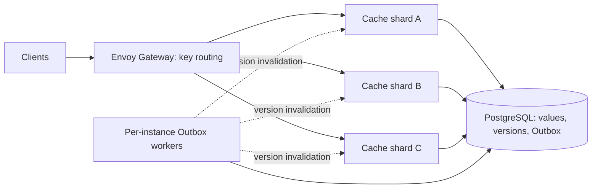

# SimpleCache design and operation

SimpleCache is a PostgreSQL-backed loading cache. Cache instances always serve
local reads; Envoy Gateway can choose a shard using a canonical request key.
There is one cache read implementation and no inter-instance value-read protocol.
A deployment without Gateway exposes independent local cache replicas.

## Architecture



The Operator manages StatefulSet, API/headless/shard Services and optional Gateway
resources. Stable shard Service addresses survive Pod replacement. EndpointSlice
discovery supplies notification recipients, not read ownership. There are no
cache replicas per shard, cache migration, strong reads or global notification
barriers. Gateway health and routing converge asynchronously during topology
changes. PostgreSQL remains authoritative; caches are disposable.

## Reads, capacity and admission

A request uses local LRU/TTL first. Misses acquire a bounded API waiter and share
a source singleflight for the same key/fence. A separate limiter bounds executing
source calls and pending tasks. Admission rejects with 503 / Retry-After rather
than indefinitely queueing. Hits bypass miss admission. Caller cancellation stops
waiting; the useful source flight retains its own lifecycle and deadline.

`CACHE_BYTES` counts key plus value bytes, not Go metadata, process RSS, incoming
connections or in-flight values. A value larger than cache capacity is returned
without inserting it or clearing unrelated entries. Values are at most 1 MiB;
keys are 1-256 UTF-8 bytes without NUL. Expiration is enforced on access and by a
bounded maintenance cursor (128 checks, best-effort 2ms budget per pass by
default). Hits refresh LRU recency, never the TTL deadline. There is no implicit
stale-on-error fallback after expiry.

Versioned sources return value/version from one snapshot. Versions must be
positive. Under one `epochMu -> cache.mu` critical section, the cache checks an
observed version minimum and admits a fill only if the captured epoch still
matches. Notifications maintain bounded floors (1,024 records / 256 epoch
stripes). Floor retirement also fences pre-retirement work. An active task keeps
its minimum independently of metadata retirement. A stale source load can retry
once within its original deadline; other failures do not trigger blind retries.

## API and consistency

- `GET /api?key=<canonical-key>`: value and strong source-version ETag `"vN"`.
- `PUT /api?key=...`: valid JSON, authenticated; use one exact `If-Match: "vN"`
  to replace, or `If-None-Match: *` to create an absent/deleted key.
- `DELETE /api?key=...`: authenticated; requires an exact current If-Match.
- `POST /invalidate?key=...`: authenticated notification only; optional positive
  `X-SimpleCache-Invalidation-Version`, absent means force invalidation.
- `/healthz`, `/readyz`, `/metrics`: health/readiness/observability.

Canonical query means exactly one `key` parameter, uppercase percent escapes,
UTF-8, `%20` for spaces and no alternate encodings. For example `product:42` is
`key=product%3A42`. Unknown parameters, duplicate keys and `+` space aliases are
rejected before source access.

Source updates use atomic PostgreSQL conditions and insert an Outbox event in the
same SQL statement/transaction. A mismatch returns 412 and makes no change.
Tombstones retain monotonically increasing generations through delete/recreate.
External SQL writers must maintain the data/version/event transaction explicitly;
there is no automatic trigger or CDC.

A committed write returns `source_committed=true`, its source version and one
known-members snapshot notification report. HTTP 200 means that snapshot was
acknowledged; 202 means the source committed but some acknowledgements failed.
Source failures can represent ambiguous commits: `source_committed=null`, not a
guaranteed rollback. Started writes are not canceled by caller disconnect.
An old-condition retry after a lost successful response returns 412; there is no
idempotent result storage or automatic replay of the first response.

This is weak consistency. In-flight responses, unseen/offline caches and missed
notifications can expose old values. Notification acknowledgements are not a
linearizable read barrier. TTL is a per-fill lifetime, not a fixed freshness SLA
measured from a later commit. Old ETags cannot overwrite a different source
version. The version-guarded reference client in tests illustrates late-response
handling; it is not a shipped SDK.

## Notification transport and Outbox

Internal port 8001 accepts only authenticated DELETE at
`/_simplecache/invalidate/<group>/<escaped-key>`, echoes the version it accepted,
and never forwards a read or modifies the source. A directory snapshot captures
all targets for bounded fan-out (up to eight workers, 1s notification budget).
Repeated/out-of-order versions preserve newer cached values; force invalidation
retains known floors. The directory is closed after HTTP/relay shutdown.

One PostgreSQL search_path/Outbox serves one invalidation domain. Every authorized
application process starts one relay. Claim uses SKIP LOCKED and increments a
lease token. Send occurs outside database transactions. Finish requires the same
unexpired token. Expired or ambiguous claims/acks are reclaimable; duplicate
redelivery is safe. A nonempty successful known-member snapshot permits finish;
unseen/offline copies still rely on TTL/recovery. Separate independent cache
clusters must not consume the same queue as competing subscribers.

Defaults: 10s lease, 2s delivery budget, 1s storage operations, 1s idle polling,
retry delay from 1s doubling to 60s. Every 30s the worker samples backlog/storage
and purges completed records older than seven days in 1,000-row batches under one
shared 1s cleanup budget. Pending records are never purged. Seven days is deletion
eligibility, not a storage size guarantee. All workers share their source pool;
queue statistics can be expensive with large backlog.

Monitor pending events/oldest age, purge-eligible delivered records and total
Outbox table/index bytes. These gauges sample the same shared queue and must not
be summed across Pods. See [Outbox contract](../geecache-engine/internal/outbox/README.md).

## Running and configuration

Single-node development needs no Gateway:

```bash
cd geecache-engine
go run -buildvcs=false ./cmd/simplecache -port=8001 -api=true
curl -fsS 'http://localhost:9999/api?key=Auto-666'
```

<a id="postgresql-example"></a>

PostgreSQL example (three independent local caches with notification fan-out):

```bash
docker compose -f deploy/products/compose.yaml up -d --build
curl -fsS 'http://127.0.0.1:19999/api?key=product%3A42'
```

Use the Operator's `spec.gateway` plus `--enable-gateway` and the pinned Envoy
Gateway APIs for distributed key sharding. RoundRobin/consistent-hash experiments
both use Gateway and the same local-read engine. Without Gateway, access to an
arbitrary instance can duplicate values and source work across replicas.

| Setting | Default / meaning |
| --- | --- |
| `SOURCE_MODE` | demo; postgres requires DATABASE_URL and CACHE_ADMIN_TOKEN |
| `API_ADDR` | 0.0.0.0:9999; CLI API enabled by default |
| `-port` | 8001, notification listener; `-api=false` closes the business API only |
| `CACHE_BYTES` | 64 MiB, valid 1-128 MiB |
| `TTL_SECONDS` | 60, integer seconds, valid 1-3600 |
| `SOURCE_MAX_CONCURRENCY` | 32, valid 1-1024 |
| `SOURCE_MAX_PENDING` | 128; explicit zero disables queuing |
| `MAX_MISS_WAITERS` | 128, valid 1-4096 |
| `WRITE_MAX_CONCURRENCY` | 16, valid 1-256; includes buffering and notification |
| `DISCOVERY_MODE` | static or kubernetes |
| `SELF_ADDR`, `MEMBERS` | static notification addresses; MEMBERS defaults to self |
| `POD_NAME`, `POD_NAMESPACE`, `CLUSTER_SERVICE` | Kubernetes identity and headless notification Service |
| `DEBUG_ADDR` | opt-in literal loopback listener; profiling never uses public DefaultServeMux |

API read wait is 1500ms; shared source work defaults to 800ms. Mutation work has a
3s lifecycle, including an independent 800ms source-write budget. PostgreSQL
startup check is 5s. Header/body/idle/response-write server budgets are
3s/5s/30s/10s; HTTP drain is 5s. These budgets are independent policies.

The CR supports size (1-10), cacheBytes, TTL, sourceSecret, miss/pending/write
budgets, resources and optional gateway configuration. Name must be a lowercase
DNS label starting with a letter, max 59 chars without Gateway or 55 with it.
Default requests are 100m CPU/128 MiB; default memory limit is 256 MiB. Secrets
remain same-namespace references; the controller never reads credential contents.

### Migration from the retired read mode

This is an incompatible runtime/configuration cleanup. Pause writes while
upgrading the engine, Operator/CRD and deployment configuration together. Mixed
old/new notification transports are not supported. Product/Outbox SQL schema and
existing generations are unchanged. Keep the existing `-svc` Service identity;
its EndpointSlice port name becomes `cluster`.

| Removed setting/feature | Replacement |
| --- | --- |
| `READ_ROUTING_MODE` (including gateway) | Remove it; every instance reads locally |
| `HOT_CACHE_BYTES`, CR `hotCacheBytes` | Remove; remote read copies no longer exist |
| `PEERS`, `PEER_SERVICE` | `MEMBERS`, `CLUSTER_SERVICE`, notification recipients only |
| Inter-instance GET / Protobuf / hash ring | Gateway key routing and local source loading |
| Old internal invalidation URI | `/_simplecache/invalidate/...`, version/ack headers unchanged |
| `postgres-compare` and its separate runtime | Gateway routing controls and production-runtime arrival qualification |

Obsolete nonempty environment settings fail startup with guidance. Regenerate
and apply the new CRD; remove obsolete fields from CR manifests. Probe readiness,
read a known key, perform one conditional update and verify all discovered members
acknowledge before resuming normal writes. Version/TTL recovery boundaries remain.

## Validation and evidence

```bash
make check
make test-operator-ci
make generated-check k8s-render compose-config
make validate
make gateway-smoke
make gateway-experiments
make gateway-perf
make gateway-arrival
make arrival-calibration
```

Real PostgreSQL tests require a dedicated initialized
`SIMPLECACHE_TEST_DATABASE_URL`; otherwise they explicitly skip. Tests cover
conditions, tombstones, duplicate/out-of-order notifications, old fills, response
loss, SIGKILL after commit, Outbox replay and lease fencing. Operator envtest does
not run workload/network controllers. Kind experiments create unique scoped
clusters, preserve logs/identities and clean their resources. Notification GET
rejection is checked explicitly in the real-cluster suite.

[Arrival experiments](experiments/arrival.md) and [Kind arrival experiments](experiments/arrival-kind.md)
explain open-loop schedules, client calibration, cohorts, resources and current
limits. Historical local reports remain under ignored `bin/reports/` with their
original binaries/contexts; old Peer results are historical, not evidence for a
currently supported mode. There are no new production capacity claims from this
refactor. Next evidence priorities are large values, working-set sweeps, cold
hotspots, source slowdown and long-duration overload/recovery.
